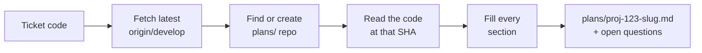

<div align="center">

# 📐 implementation-plan

**Turn one ticket into a researched, verifiable implementation plan,
checked against your real code before a single line is written.**

[](LICENSE)
[](https://agentskills.io)
[](#claude-code)
[](#install)

[Quick start](#quick-start) · [What you get](#what-you-get) · [How it works](#how-it-works) · [Install](#install) · [Use](#use) · [Customise](#customise)

</div>

---

Most AI-written plans are to-do lists written from memory. This skill makes your agent **read the
code first**. Every claim in the plan cites `file:line`, every decision names the alternative it
rejected, and every step is one commit with a check you can run.

The plan is written to your project's private `plans/` repo and leaves nothing for the implementer
to guess. A cheaper model can build it step by step while a stronger one reviews each commit.

**Works with:** Claude Code · OpenAI Codex · Google Antigravity · Gemini CLI · Cursor · GitHub
Copilot · OpenCode, and any other agent that reads `SKILL.md` skills.

<a id="quick-start"></a>

## ⚡ Quick start

```bash
npx skills add lllmoseslll/claude-implementation-plan-skill -a claude-code -a codex -a antigravity
```

Then ask your agent:

> Write an implementation plan for PROJ-123

Using Claude Code? You can also install it as a plugin. See [Claude Code](#claude-code).

<a id="what-you-get"></a>

## 📋 What you get

One Markdown file, `plans/<ticket-id>-<slug>.md`, with these sections:

| § | Section | What makes it different |
|:-:|---|---|
| 0 | **Contract** | The branch name, the base SHA from a freshly fetched `origin/<integration>`, the commit format and the PR target |
| 1 | **Context** | Every claim cites `path/to/file.ext:line`, read at that SHA. A search that found nothing counts as a finding too |
| 2 | **Research** | Each borrowed pattern or library, and *why it applies here* |
| 3 | **Decisions** | Numbered, each with a rejected alternative. An open question gets a safe default and a gating step instead of a silent guess |
| 4 | **Steps** | One commit per step, each with a **Verify:** line of checks you can observe and the exact commit message |
| 5 | **Risks** | Each tied to a step, including the **cut line**: where to stop if the plan has to be cut |
| 6 | **End-to-end verification** | The acceptance journeys for the whole branch, run before the PR |
| 7 | **Execution prompts** | Who builds and who reviews each step, in landing order |
| 8 | **Session log** | Filled in as each step lands: what the plan got wrong, and the tests that prove it now works |
| 9 | **Pull request** | The title, description and review rules |

<details>
<summary><b>See an example step</b></summary>

```markdown
#### Step 3 — Reject requests over the tenant's rate limit (D2; FR-04).
Add `RateLimitFilter` in `api/src/main/java/.../filter/RateLimitFilter.java`, registered after
authentication. Over the limit it returns `429` with a `Retry-After` header and the standard
error body. Do not touch `PublicHealthController`, which must stay unthrottled.
**Verify:** `RateLimitFilterTest` passes 6 tests including tenant B unaffected by tenant A's
burst; `/health` returns 200 under load; `./gradlew check` green.

**Commit:** `PROJ-123 Add per-tenant rate limiting`
```

</details>

<a id="how-it-works"></a>

## ⚙️ How it works



1. **Asks** for the ticket code (if you didn't give one) and what the ticket is asking for.
2. **Fetches** the latest remote integration branch (`develop`, else `dev`) and records its SHA.
3. **Finds** the project's `plans/` repo by walking up from the working directory. If there is
   none, it creates one at the project root and keeps it out of the product repo with
   `.git/info/exclude`.
4. **Researches** the code at that SHA and fills every mandatory section of the template.
5. **Writes** the plan and lists every open question with the step it blocks.

> [!NOTE]
> The skill never creates the branch, commits or pushes. Those stay your call.

<a id="install"></a>

## 📦 Install

Every agent needs the same folder, `skills/implementation-plan/`. Keep `SKILL.md` and
`template.md` together and keep the folder named `implementation-plan`.

| Agent | Fastest install |
|---|---|
| **Any agent** | `npx skills add lllmoseslll/claude-implementation-plan-skill -a <agent>` |
| **Claude Code** | `/plugin marketplace add lllmoseslll/claude-implementation-plan-skill` |
| **OpenAI Codex** | `npx skills add lllmoseslll/claude-implementation-plan-skill -a codex -g` |
| **Google Antigravity** | `npx skills add lllmoseslll/claude-implementation-plan-skill -a antigravity -g` |
| **Gemini CLI** | `gemini skills install <repo-url> --path skills/implementation-plan` |
| **GitHub Copilot** | `gh skill install lllmoseslll/claude-implementation-plan-skill implementation-plan` |
| **Cursor · OpenCode** | `npx skills add … -a cursor` or `-a opencode` |

Open your agent below for the full steps and the manual copy option.

<details>
<summary><b>Any agent: <code>npx skills</code></b></summary>

The [`skills`](https://github.com/vercel-labs/skills) CLI installs the skill for one or more
agents at once. It needs Node.js.

```bash
# Into the current project, for the agents you name
npx skills add lllmoseslll/claude-implementation-plan-skill -a codex -a antigravity

# For every project on your machine (user scope)
npx skills add lllmoseslll/claude-implementation-plan-skill -a codex -g

# See what it would install without installing
npx skills add lllmoseslll/claude-implementation-plan-skill -l
```

- **Agent names for `-a`:** `claude-code`, `codex`, `antigravity`, `gemini-cli`, `cursor`,
  `github-copilot`, `opencode`.
- **On Windows,** add `--copy` to copy the files instead of symlinking them.
- **Privacy:** the CLI sends the repo and skill name as anonymous usage stats. Set
  `DISABLE_TELEMETRY=1` to turn that off.

</details>

<a id="claude-code"></a>
<details>
<summary><b>Claude Code</b></summary>

**As a plugin (recommended),** inside Claude Code:

```
/plugin marketplace add lllmoseslll/claude-implementation-plan-skill
/plugin install implementation-plan@claude-implementation-plan-skill
```

To update later, run `/plugin marketplace update claude-implementation-plan-skill`.

**Or copy the folder by hand:**

```bash
git clone https://github.com/lllmoseslll/claude-implementation-plan-skill.git
mkdir -p ~/.claude/skills
cp -r claude-implementation-plan-skill/skills/implementation-plan ~/.claude/skills/
```

To use it in one project only, copy it into that project's `.claude/skills/` instead.

</details>

<details>
<summary><b>OpenAI Codex</b></summary>

```bash
npx skills add lllmoseslll/claude-implementation-plan-skill -a codex -g
```

**Or copy the folder by hand.** Codex reads `~/.agents/skills/` for all projects and
`.agents/skills/` inside a project.

```bash
git clone https://github.com/lllmoseslll/claude-implementation-plan-skill.git
mkdir -p ~/.agents/skills
cp -r claude-implementation-plan-skill/skills/implementation-plan ~/.agents/skills/
```

</details>

<details>
<summary><b>Google Antigravity</b></summary>

```bash
npx skills add lllmoseslll/claude-implementation-plan-skill -a antigravity -g
```

**Or copy the folder by hand.** Antigravity reads `~/.gemini/config/skills/` for all projects and
`.agents/skills/` inside a project. If Antigravity was already open, run `/skills reload`.

```bash
git clone https://github.com/lllmoseslll/claude-implementation-plan-skill.git
mkdir -p ~/.gemini/config/skills
cp -r claude-implementation-plan-skill/skills/implementation-plan ~/.gemini/config/skills/
```

</details>

<details>
<summary><b>Gemini CLI</b></summary>

```bash
gemini skills install https://github.com/lllmoseslll/claude-implementation-plan-skill.git \
  --path skills/implementation-plan --scope user
```

Or copy the folder into `~/.gemini/skills/` (all projects) or `.gemini/skills/` (one project).

</details>

<details>
<summary><b>GitHub Copilot</b></summary>

```bash
gh skill install lllmoseslll/claude-implementation-plan-skill implementation-plan --scope user
```

Or copy the folder into `~/.copilot/skills/` (all projects) or `.github/skills/` (one project).

</details>

<details>
<summary><b>Cursor and OpenCode</b></summary>

Use `npx skills add … -a cursor` or `-a opencode`, or copy the folder by hand:

| Agent | All projects | One project |
|---|---|---|
| Cursor | `~/.cursor/skills/` | `.cursor/skills/` |
| OpenCode | `~/.config/opencode/skills/` | `.opencode/skills/` |

</details>

> [!TIP]
> **Team on several agents?** Every agent above also reads `.agents/skills/` inside a project. Put
> the skill there once and commit it with the project:
>
> ```bash
> mkdir -p .agents/skills
> cp -r claude-implementation-plan-skill/skills/implementation-plan .agents/skills/
> ```

<a id="use"></a>

## 🚀 Use

Ask your agent to plan a ticket, for example *"write an implementation plan for PROJ-123"*. It picks
the skill up from its description. You can also start it by name:

| Agent | Command |
|---|---|
| Claude Code | `/implementation-plan PROJ-123` |
| Codex | `$implementation-plan PROJ-123`, or pick it from `/skills` |
| Others | Ask for an implementation plan, or use the agent's skills menu |

<a id="customise"></a>

## 🎛 Customise

**Conventions.** The template assumes the conventions below. Change template §0 if your team's
differ.

| | Convention |
|---|---|
| Branch | `feature/<TICKET-ID>-<lowercase-hyphen-description>`, from `origin/develop` |
| Commit | `<TICKET-ID> <Sentence case imperative description>`, under 72 characters, no trailing period |
| Shape | One ticket · one branch · one commit per step · one PR |

**Model roles.** The "Who does what" section of `SKILL.md` is written for Claude Code:

| Role | In Claude Code | In any other agent |
|---|---|---|
| Plans and reviews | Fable, else Opus | Your strongest model |
| Builds each step | Sonnet at high effort, as a subagent | A cheaper capable model, as a subagent if your agent has them |
| No subagents? | | The agent builds each step itself, reviews the whole diff and re-runs the step's Verify line before committing |

Edit that section to match the models you have.

## 🗂 Repository layout

```
.claude-plugin/
├── plugin.json          Claude Code plugin manifest
└── marketplace.json     lets this repo be added as a plugin marketplace
skills/implementation-plan/
├── SKILL.md             the skill's instructions
└── template.md          the plan template; every ">" line is an authoring rule
```

## 📄 License

[MIT](LICENSE): free to use, change and share.
